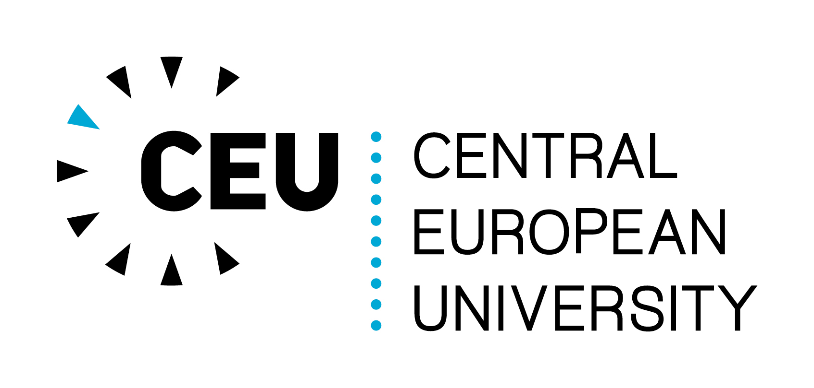

<table style="width: 100%;">
  <tr>
	<td style="width: 70%; border-bottom:0px;"><h1>Welcome.</h1></td>
	<td style="width: 30%; border-bottom:0px;"></td>
  </tr>
</table>

I am a Postdoctoral Researcher in Economics at Central European University. My research examines how managerial behavior and firm dynamics shape macroeconomic outcomes. I am also interested in questions relating to empirical industrial organization, applied microeconometrics and unstructured (text) data.

I am also a Visiting Lecturer at CEU.

 

**Contact Information:**

Email: wohaku [at] ceu [dot] edu
